# Como iniciar sesion en Aviva Chat (iPhone)
## Guia rapida

- Esta guia explica el acceso en iPhone paso a paso
- Flujo principal: usuario + contrasena
- QR tambien existe, pero no es el flujo principal de este manual

---

# Paso #1 - Instalar TestFlight

- Descarga TestFlight desde Apple:
- `https://apps.apple.com/app/testflight/id899247664`

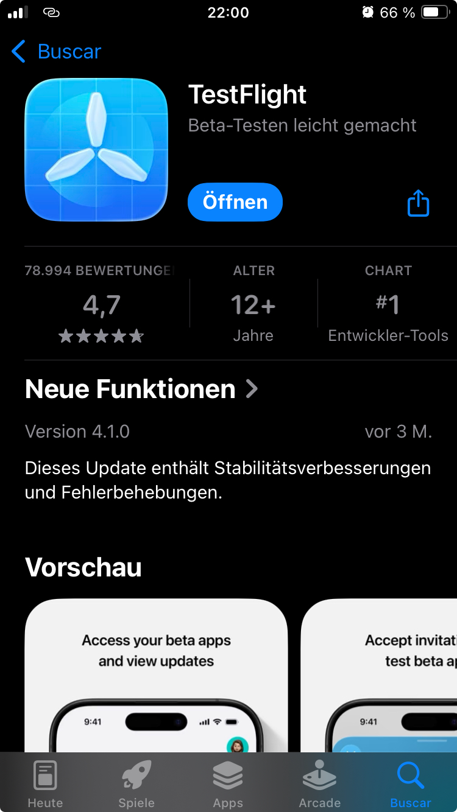

---

# Paso #2 - Abrir invitacion por email

- Recibiras un correo de invitacion
- Pulsa el boton azul **View in TestFlight**

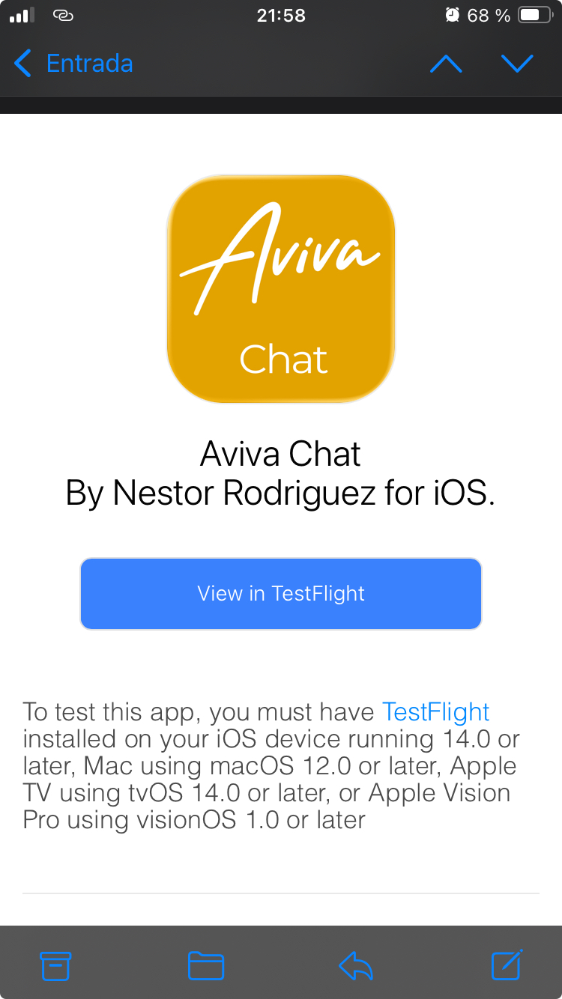

---

# Paso #3 - Instalar Aviva Chat en TestFlight

- Se abrira TestFlight
- Veras **Aviva Chat** listo para instalar y abrir

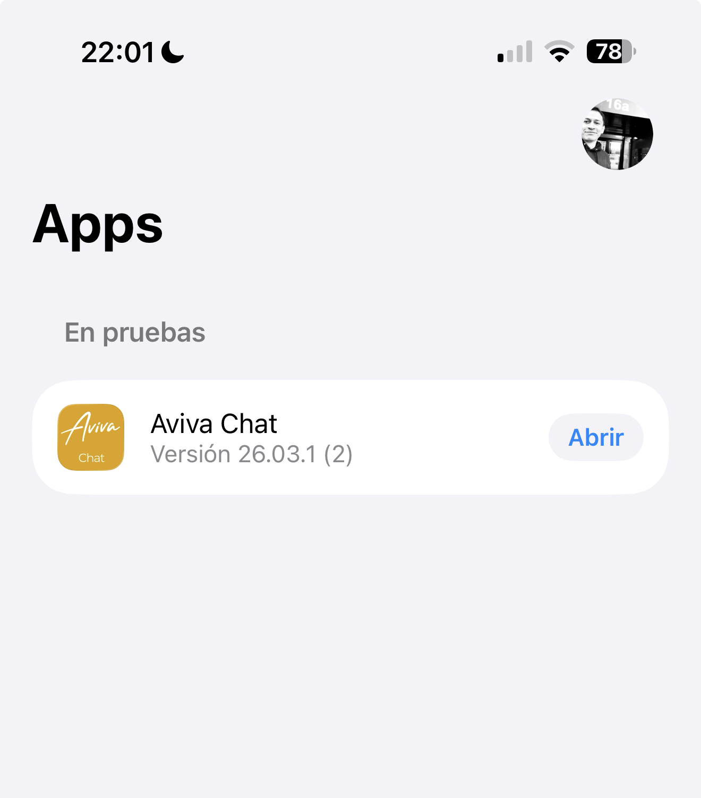

---

# Paso #4 - Pantalla de acceso

- Abre Aviva Chat
- Elige **Iniciar Session en chat.avivaeu.org**

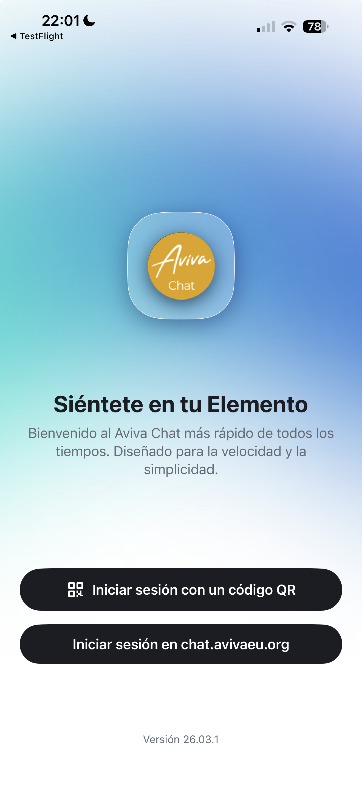

---

# Paso #5 - Confirmar apertura del navegador

- Se mostrara un dialogo de confirmacion
- Pulsa **Continuar**

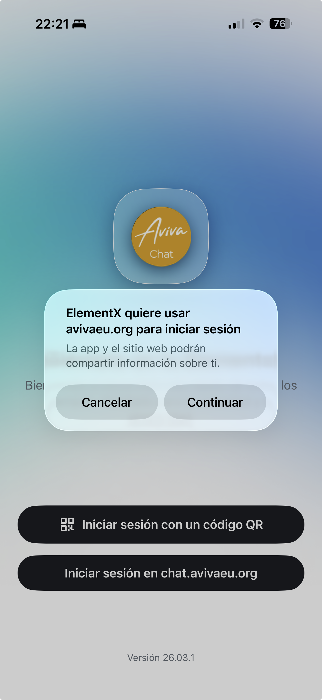

---

# Paso #6 - Escribir usuario y contrasena

- Inicia sesion con tu usuario y contrasena de Aviva Chat
- Pulsa **Continuar**

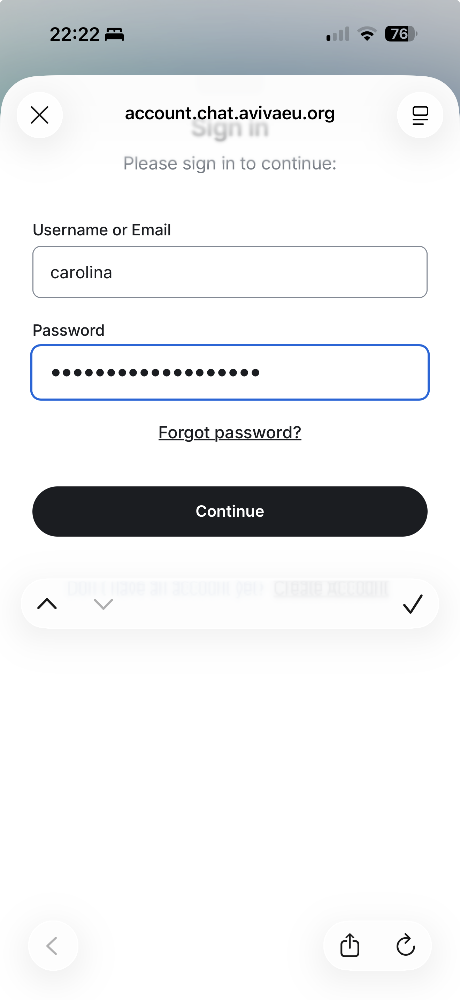

---

# Paso #7 - Confirmacion de inicio de sesion

- Veras la pantalla de confirmacion
- Pulsa **Continuar**

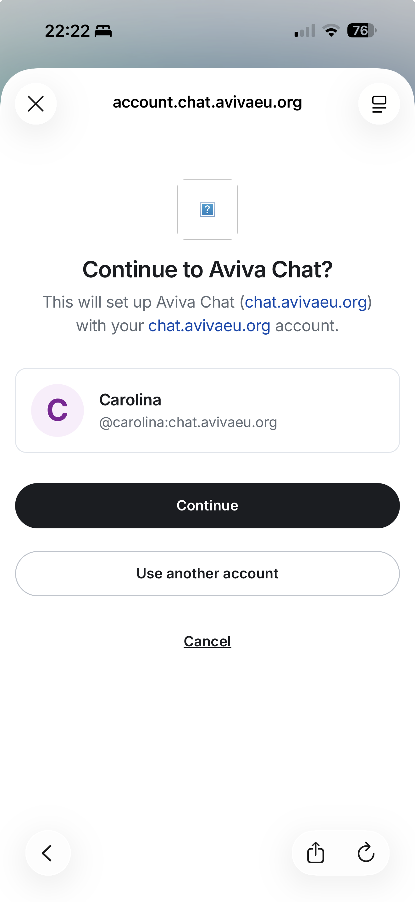

---

# Paso #8 - Seguridad del dispositivo

- En el movil, pulsa **Usar otro dispositivo**
- PARTE WEB DESDE AQUI
- Debes abrir el navegador en `https://chat.avivaeu.org`
- Debes iniciar sesion en la Web (ver manual anterior)

<strong>Importante:</strong> sin sesion activa en la <strong>Web</strong>, no podras confirmar la verificacion del iPhone.

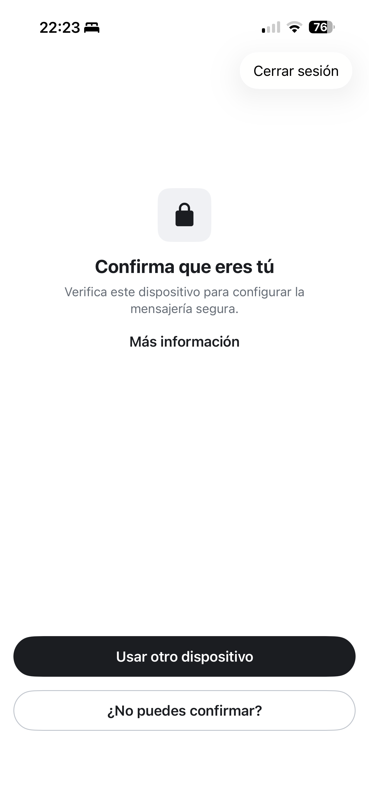

---

# Paso #9 - Iniciar verificacion

- En el movil, pulsa **Iniciar Verificacion**
- Esto disparara una confirmacion en la sesion web

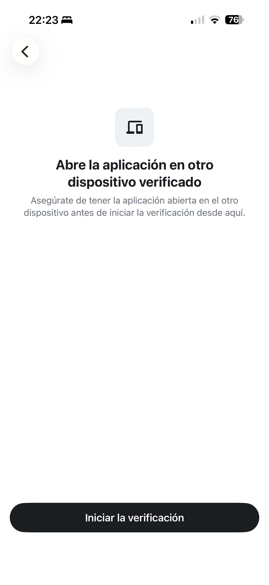

---

# Paso #10 - Confirmar en la Web

- PASO EN WEB
- En la Web de Aviva Chat, pulsa **Verificar Dispositivo**
- La flecha verde en la imagen marca el boton correcto

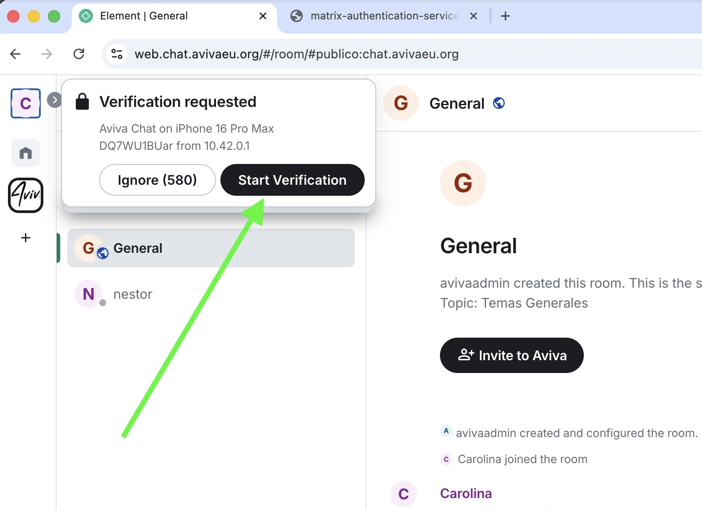

---

# Paso #11 - Comparar emojis en la Web

- PASO EN WEB
- La Web mostrara un conjunto de emojis
- Si coinciden con el movil, pulsa **Coinciden**

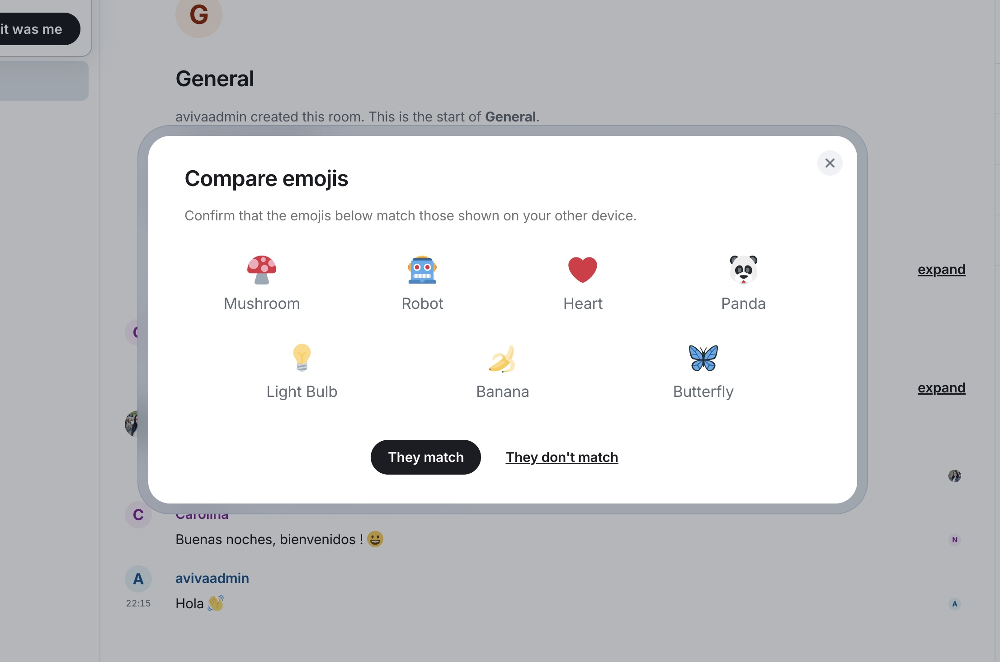

---

# Paso #12 - Confirmar emojis en el iPhone

- En el movil veras los mismos emojis
- Pulsa **Coinciden**

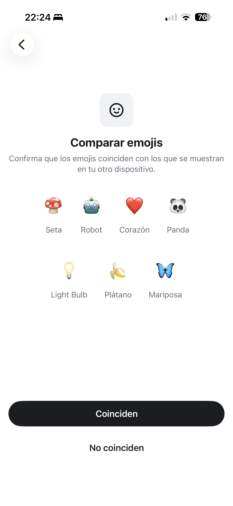

---

# Paso #13 - Acceso completado

- Listo: ya quedas dentro de Aviva Chat
- Ya puedes unirte y chatear

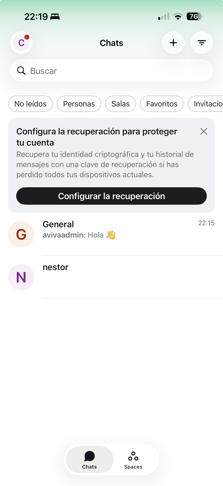

---

# Paso #14 - App instalada en iPhone

- Verifica el icono de Aviva Chat en tu iPhone
- Ya puedes abrir la app cuando quieras

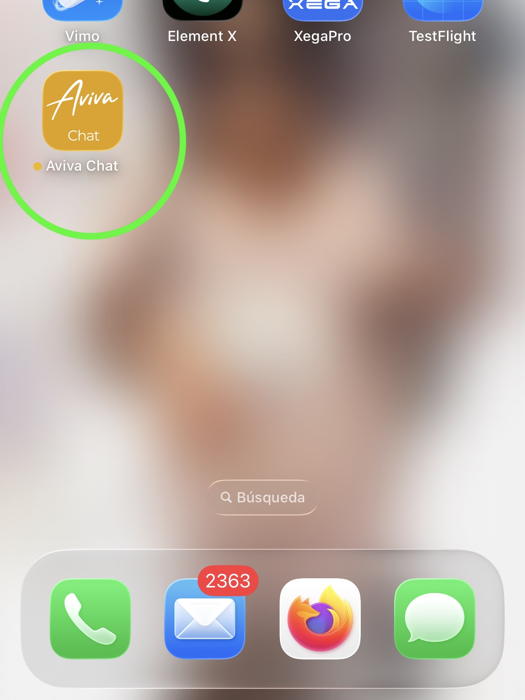

---

# Checklist final

- [ ] TestFlight instalado
- [ ] Aviva Chat instalado
- [ ] Inicio de sesion completado
- [ ] Verificacion por emojis completada
- [ ] App lista para usar
