# Como registrarse en Aviva Chat
## Guia rapida

- URL: `https://chat.avivaeu.org`
- Crea tu cuenta con el token que te compartimos
- Entra a `Aviva > General` y escribe tu primer mensaje

---

# Paso #1 - Abrir Aviva Chat

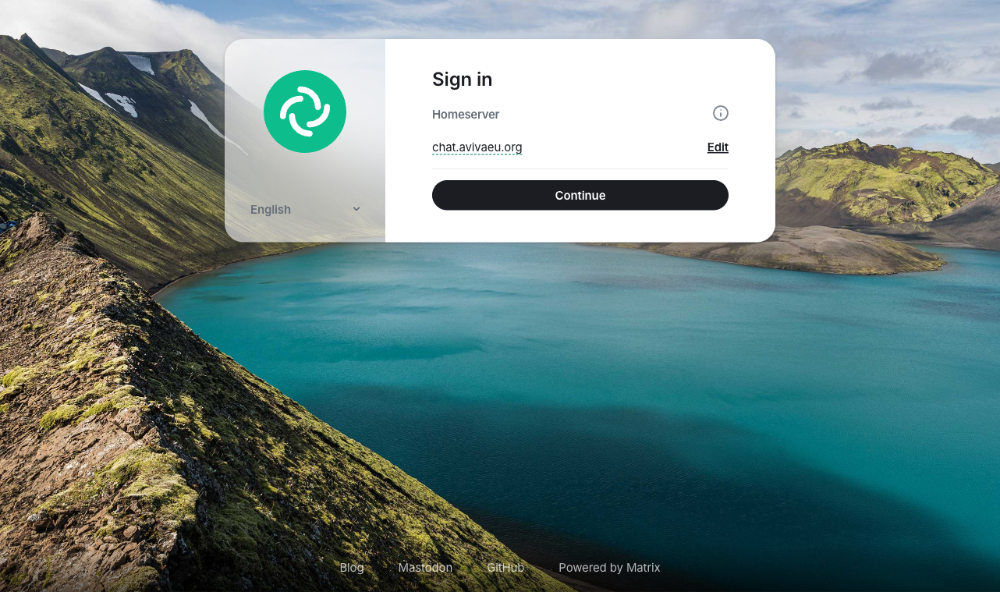

---

# Paso #2 - Crear cuenta

- Haz clic en **Continue**
- Luego selecciona **Create Account**

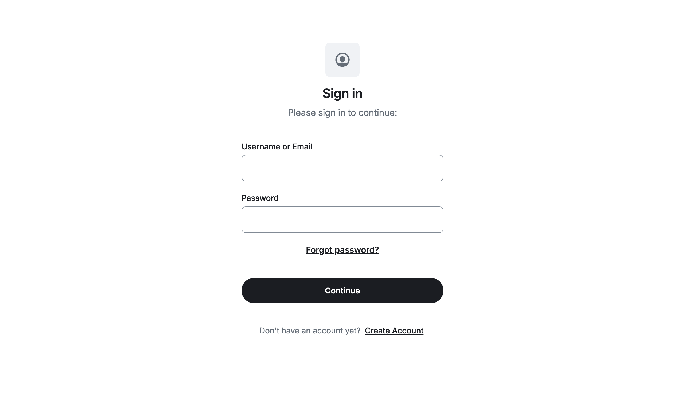

---

# Paso #3 - Usuario y contrasena

- Escribe tu usuario
- Escribe y confirma tu contrasena

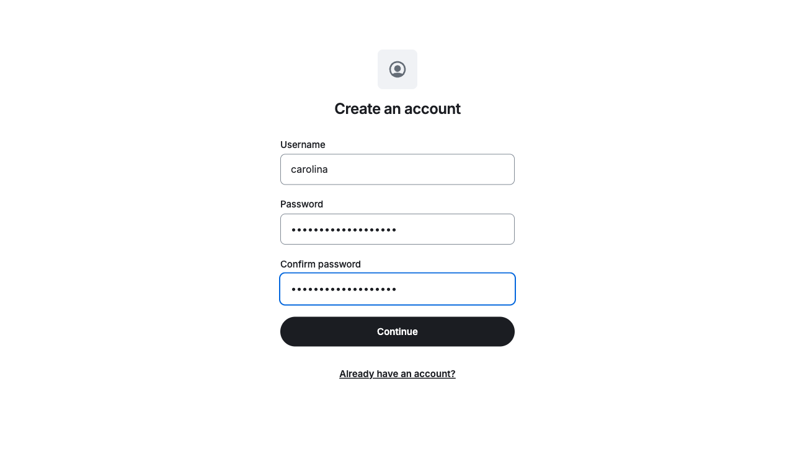

---

# Paso #4 - Pegar token

- Pega el token que te enviamos
- Pulsa **Continue** para seguir

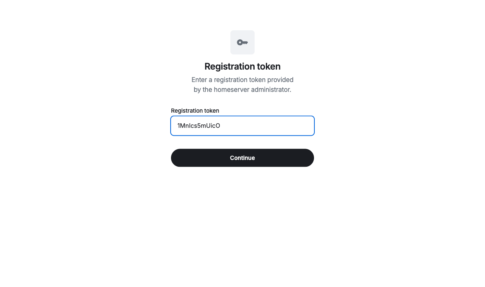

---

# Paso #5 - Finalizar registro

- (Opcional) Escribe tu nombre visible
- Pulsa **Continue to Element** para terminar

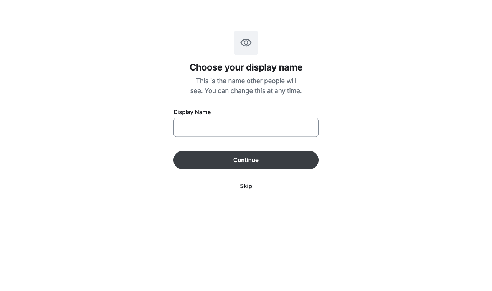
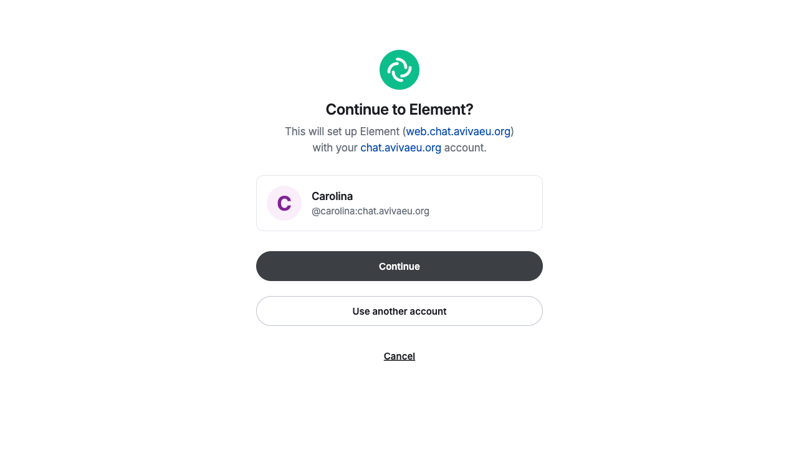

---

# Paso #6 - Confirmar acceso

- Si ves esta pantalla, ya estas dentro
- Siguiente paso: abrir el espacio Aviva

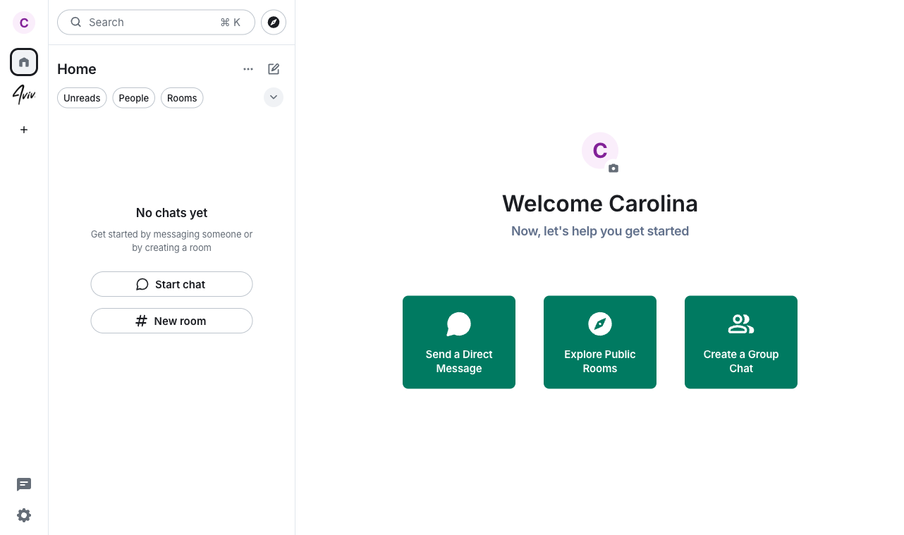

---

# Paso #7 - Abrir Aviva

- Selecciona **Aviva** en la barra de espacios
- Entra a la sala **General**

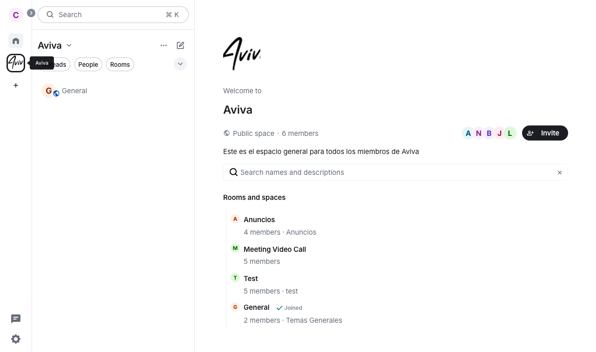

---

# Paso #8 - Entrar en General

- Ya dentro de **General**, escribe tu primer mensaje
- Ejemplo: `Hola, ya estoy en Aviva Chat`

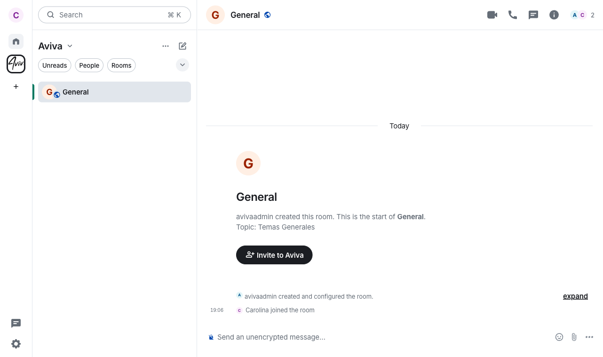

---

# Paso #9 - Saludo en General

- En la sala **General**, envia un mensaje para presentarte
- Ejemplo: `Hola a todos! 👋😊`

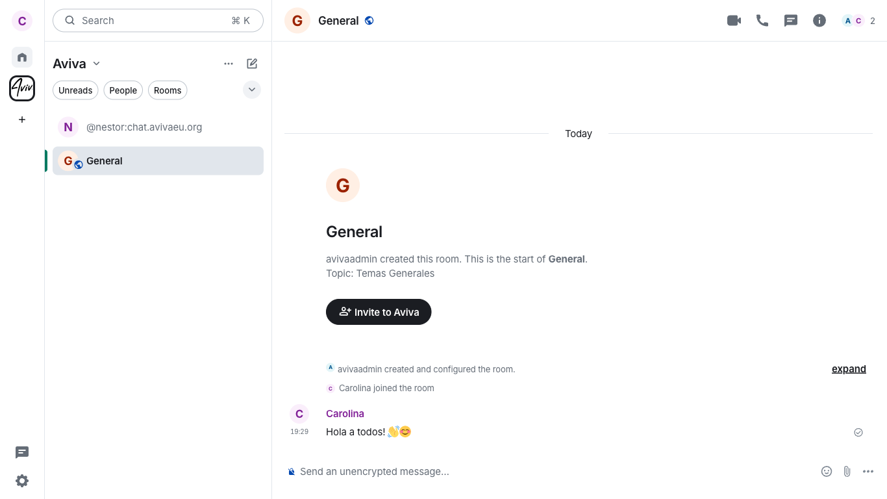

---

# Paso #10 - Chat 1 a 1

- Chat directo de `Carolina` con `@nestor:chat.avivaeu.org`
- Mensaje enviado: `Hola ya me registre en Aviva Chat :)`

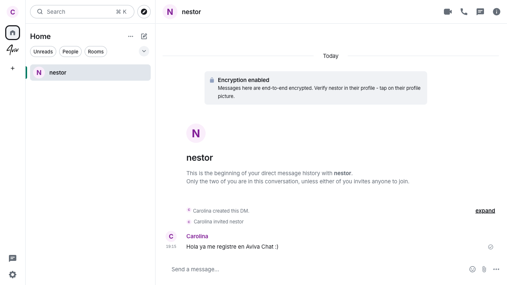

---

# Troubleshooting rapido

- **No te deja crear cuenta**: revisa usuario/contrasena o pide ayuda
- **No ves Aviva o General**: usa `Search` o pide invitacion

---

# Checklist final

- [ ] Cuenta creada
- [ ] Entraste a `Aviva > General`
- [ ] Enviaste tu primer mensaje
